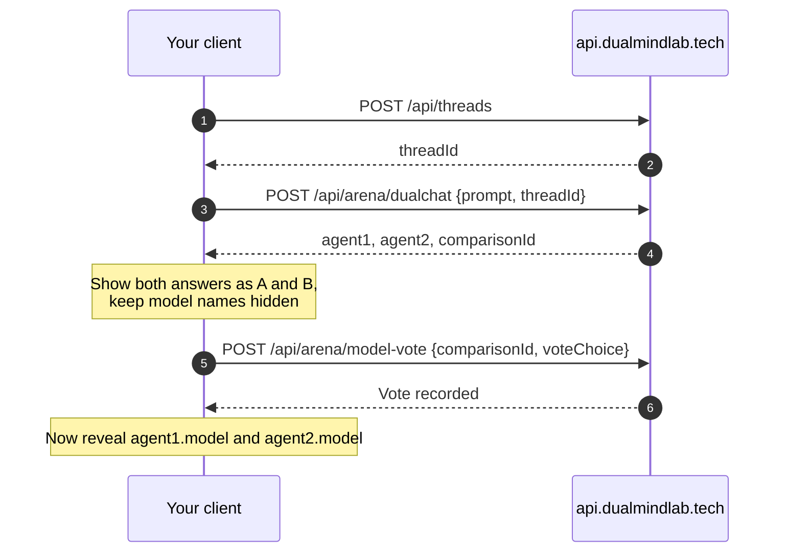

import TokenWarning from "/snippets/token-warning.mdx"
import FallbackNote from "/snippets/fallback-note.mdx"

This tutorial builds the core Arena loop against the API. You'll need an access token in `DUALMIND_TOKEN` ([how to get one](/api-reference/authentication)).

<TokenWarning />



<Steps>
  <Step title="Create a thread (optional)">
    Threads keep battles together and make them shareable. Skip this step if you don't need history.

    <CodeGroup>
    ```bash cURL
    THREAD_ID=$(curl -s {{apiBase}}/api/threads \
      -H "Authorization: Bearer $DUALMIND_TOKEN" -H "Content-Type: application/json" \
      -d '{"title": "Haiku battles", "mode": "battle"}' | jq -r .threadId)
    ```

    ```javascript JavaScript
    const api = (path, body) =>
      fetch(`{{apiBase}}${path}`, {
        method: "POST",
        headers: { Authorization: `Bearer ${process.env.DUALMIND_TOKEN}`, "Content-Type": "application/json" },
        body: JSON.stringify(body),
      }).then(async (r) => {
        if (!r.ok) throw new Error(`${r.status} ${await r.text()}`);
        return r.json();
      });

    const { threadId } = await api("/api/threads", { title: "Haiku battles", mode: "battle" });
    ```

    ```python Python
    import os, requests

    S = requests.Session()
    S.headers["Authorization"] = f"Bearer {os.environ['DUALMIND_TOKEN']}"
    BASE = "{{apiBase}}"

    thread_id = S.post(f"{BASE}/api/threads", json={"title": "Haiku battles", "mode": "battle"}).json()["threadId"]
    ```
    </CodeGroup>
  </Step>

  <Step title="Start a blind battle">
    Leave `model1` and `model2` out so the Arena picks two random models.

    <CodeGroup>
    ```bash cURL
    curl -s {{apiBase}}/api/arena/dualchat --max-time 150 \
      -H "Authorization: Bearer $DUALMIND_TOKEN" -H "Content-Type: application/json" \
      -d "{\"prompt\": \"Write a haiku about distributed systems\", \"threadId\": \"$THREAD_ID\"}" > battle.json
    jq -r '.comparisonId, .agent1.message, "---", .agent2.message' battle.json
    ```

    ```javascript JavaScript
    const battle = await api("/api/arena/dualchat", {
      prompt: "Write a haiku about distributed systems",
      threadId,
    });
    console.log("A:", battle.agent1.message);
    console.log("B:", battle.agent2.message);
    ```

    ```python Python
    battle = S.post(
        f"{BASE}/api/arena/dualchat",
        json={"prompt": "Write a haiku about distributed systems", "threadId": thread_id},
        timeout=150,
    ).json()
    print("A:", battle["agent1"]["message"])
    print("B:", battle["agent2"]["message"])
    ```
    </CodeGroup>
  </Step>

  <Step title="Keep the names hidden">
    The response includes each side's `model` and an `arena.models` summary so you can reveal them later. For a fair vote, **don't show these until the user has voted**:

    ```javascript
    const blind = { comparisonId: battle.comparisonId, a: battle.agent1.message, b: battle.agent2.message };
    const reveal = { a: battle.agent1.model.displayName, b: battle.agent2.model.displayName };
    ```

    <FallbackNote />
  </Step>

  <Step title="Vote">
    `left` means `agent1` won and `right` means `agent2` won. You can also send `tie` or `both-bad`. One vote per user per comparison.

    <CodeGroup>
    ```bash cURL
    curl -s {{apiBase}}/api/arena/model-vote \
      -H "Authorization: Bearer $DUALMIND_TOKEN" -H "Content-Type: application/json" \
      -d "{\"comparisonId\": \"$(jq -r .comparisonId battle.json)\", \"voteChoice\": \"left\", \"voteDurationMs\": 9000}"
    ```

    ```javascript JavaScript
    const started = Date.now();
    // ...user reads both answers and picks one...
    await api("/api/arena/model-vote", {
      comparisonId: blind.comparisonId,
      voteChoice: "left", // "left" | "right" | "tie" | "both-bad"
      voteDurationMs: Date.now() - started,
    });
    ```

    ```python Python
    S.post(
        f"{BASE}/api/arena/model-vote",
        json={"comparisonId": battle["comparisonId"], "voteChoice": "left", "voteDurationMs": 9000},
    ).raise_for_status()
    ```
    </CodeGroup>
  </Step>

  <Step title="Reveal">
    Now show the names:

    <CodeGroup>
    ```bash cURL
    jq -r '"A was \(.agent1.model.displayName) (\(.agent1.model.provider))", "B was \(.agent2.model.displayName) (\(.agent2.model.provider))"' battle.json
    ```

    ```javascript JavaScript
    console.log(`A was ${reveal.a}, B was ${reveal.b}`);
    ```

    ```python Python
    a, b = battle["agent1"]["model"], battle["agent2"]["model"]
    print(f"A was {a['displayName']} ({a['provider']}), B was {b['displayName']} ({b['provider']})")
    ```
    </CodeGroup>
  </Step>
</Steps>

## Variations

<AccordionGroup>
  <Accordion title="Side by Side: choose both models" icon="columns-2">
    Pass both `model1` and `model2` (a `modelName` or `modelId` from [List models](/api-reference/models/list-models)):

    ```json
    { "prompt": "Explain CRDTs in 3 sentences", "model1": "llama-3.3-70b-versatile", "model2": "gemini-2.5-flash" }
    ```
  </Accordion>
  <Accordion title="Topper: challenge the leader" icon="crown">
    ```json
    { "prompt": "Prove that there are infinitely many primes", "selectionMode": "topper" }
    ```
  </Accordion>
  <Accordion title="Same settings for both sides" icon="sliders-horizontal">
    `system`, `maxTokens` and `temperature` apply to both models:

    ```json
    { "prompt": "Write a product tagline", "system": "Answer in under 12 words.", "maxTokens": 256, "temperature": 0.9 }
    ```
  </Accordion>
</AccordionGroup>

<CardGroup cols={2}>
  <Card title="Start a battle" icon="book" href="/api-reference/chat/dual-chat">Full request and response reference.</Card>
  <Card title="Submit a vote" icon="vote" href="/api-reference/voting/submit-vote">Vote options and errors.</Card>
</CardGroup>
