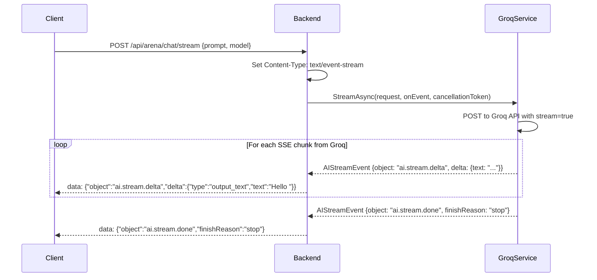
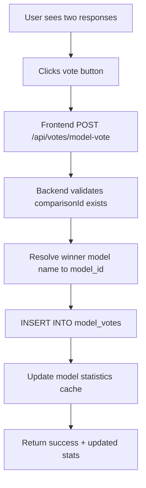
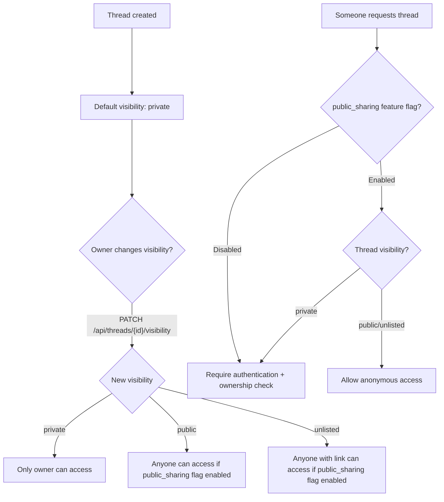
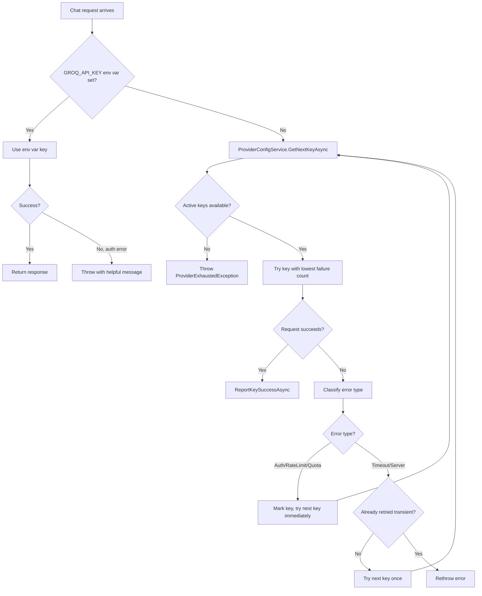

## Dual chat comparison flow (complete)

This is the primary user flow — the arena battle. Every step is documented for code generation accuracy.

<Frame caption="Complete dual-chat arena flow — from login to model reveal">
```mermaid
sequenceDiagram
    participant U as User Browser
    participant FE as Frontend (JS)
    participant SA as Supabase Auth
    participant API as .NET Backend
    participant MS as ModelSelector
    participant CPF as ChatProviderFactory
    participant GP as GroqService
    participant DB as Supabase DB

    Note over U,DB: Step 1: Authentication (happens once per session)
    U->>FE: Click "Login with Google"
    FE->>SA: supabase.auth.signInWithOAuth({provider: 'google'})
    SA-->>FE: JWT access_token (HS256, sub=user_id)
    FE->>FE: Store token in Supabase session

    Note over U,DB: Step 2: Create thread (optional)
    FE->>API: POST /api/threads {title: "New Chat"} + Bearer token
    API->>API: Extract user_id from JWT 'sub' claim
    API->>DB: UserSyncService.EnsureUserExistsAsync(userId)
    API->>DB: INSERT INTO threads (thread_id, user_id, title)
    API-->>FE: {threadId, userId, title, createdAt}

    Note over U,DB: Step 3: Send prompt to arena
    U->>FE: Types "Explain quantum computing" + clicks Send
    FE->>API: POST /api/arena/dualchat {prompt, threadId} + Bearer token

    Note over API,DB: Step 4: Model selection
    API->>MS: GetTwoRandomModelsAsync()
    MS->>DB: SELECT * FROM ai_models WHERE status='active'
    DB-->>MS: [model1: "llama-3.3-70b-versatile", model2: "mixtral-8x7b-32768"]
    MS-->>API: (model1, model2)

    Note over API,GP: Step 5: Parallel AI execution
    par Agent 1
        API->>CPF: GetProvider("groq")
        CPF-->>API: GroqService
        API->>GP: ChatAsync("llama-3.3-70b-versatile", prompt)
        GP->>GP: ExecuteWithRetryAsync(apiKey => call Groq API)
        GP-->>API: GroqResponse {message, tokens}
    and Agent 2
        API->>CPF: GetProvider("groq")
        CPF-->>API: GroqService
        API->>GP: ChatAsync("mixtral-8x7b-32768", prompt)
        GP-->>API: GroqResponse {message, tokens}
    end

    Note over API,DB: Step 6: Persist results
    API->>DB: MessageLogger.LogMessageAsync(session, model1, "agent1")
    API->>DB: MessageLogger.LogMessageAsync(session, model2, "agent2")
    API->>DB: UserSyncService.EnsureUserExistsAsync(userId)
    API->>DB: ComparisonLogger.LogComparisonAsync(comparisonId, ...)
    API->>DB: ThreadMessagesService.LogDualAsync(threadId, ...)

    Note over API,FE: Step 7: Return response
    API-->>FE: {success, agent1, agent2, comparisonId, arena}
    FE-->>U: Display both responses side-by-side (model names hidden)

    Note over U,DB: Step 8: User votes
    U->>FE: Clicks "Response A is better"
    FE->>API: POST /api/votes/model-vote {comparisonId, winner: "agent1"}
    API->>DB: INSERT INTO model_votes (comparison_id, winner_model_id, user_id)
    API-->>FE: {success: true}
    FE-->>U: Reveal model names, show vote confirmation
</Frame>

## Single chat flow

<Frame caption="Single chat with automatic fallback chain">
```mermaid
flowchart TD
    A[Client POST /api/arena/chat] --> B{Model specified?}
    B -->|"model=auto or null"| C[ModelSelector.GetRandomModelAsync]
    B -->|"model=specific"| D[Use specified model]
    C --> E[ExecuteWithFallbackAsync]
    D --> E
    E --> F{Provider resolves?}
    F -->|Yes| G[Provider.ChatAsync with 45s timeout]
    F -->|No| H[Fallback to GroqService]
    G --> I{Success?}
    I -->|Yes| J[Build ChatResponse]
    I -->|No| K{Provider was Groq?}
    K -->|No| L[Fallback to Groq + llama-3.3-70b]
    K -->|Yes| M[Try alternative Groq model]
    L --> J
    M --> J
    H --> G
    J --> N[Log message]
    N --> O{ThreadId provided?}
    O -->|Yes| P[ThreadMessagesService.LogSingleAsync]
    O -->|No| Q[Return response]
    P --> Q
```
</Frame>

## Streaming chat flow

<Frame caption="SSE streaming flow — tokens delivered in real-time">

</Frame>

**SSE event types:**

| Event `object` | Description | Fields |
|----------------|-------------|--------|
| `ai.stream.delta` | Content chunk | `delta.type` = `"output_text"`, `delta.text` = chunk text |
| `ai.stream.done` | Stream complete | `finishReason` = `"stop"`, optional `usage` |
| `ai.error` | Error occurred | `code`, `message` |

## Voting data flow

<Frame caption="Vote processing pipeline">

</Frame>

## Thread visibility and sharing

<Frame caption="Thread visibility access control">

</Frame>

## API key rotation flow


</Frame>
