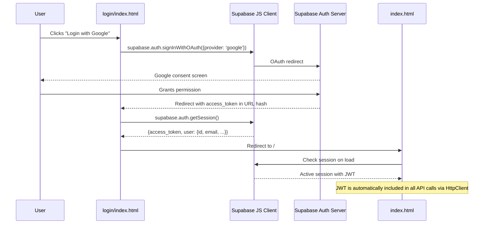

## Technology summary

| Aspect | Choice |
|--------|--------|
| **Language** | Vanilla JavaScript (ES modules) |
| **Framework** | None — plain HTML/CSS/JS |
| **Bundler** | None — served directly via `npx serve` or Cloudflare Workers |
| **Hosting** | Cloudflare Workers (production) / `serve` (local dev) |
| **Auth** | Supabase JS client (`@supabase/supabase-js` via CDN) |
| **Styling** | Custom CSS with multiple stylesheets |
| **Icons** | Font Awesome |

## Directory structure

```
DualMind UI/
├── js/
│   ├── api/
│   │   ├── DualMindApi.js          # Main API client facade (singleton export)
│   │   ├── index.js                # Re-exports for convenience
│   │   ├── config/
│   │   │   └── ApiConfig.js        # createConfig() — merges defaults with overrides
│   │   ├── core/
│   │   │   └── HttpClient.js       # fetch wrapper: retry, auth headers, error handling
│   │   └── services/
│   │       ├── ArenaService.js     # chat(), dualChat(), streamChat(), vote(), getStats()
│   │       ├── ThreadService.js    # getThreads(), createThread(), getMessages(), etc.
│   │       ├── ModelService.js     # getModels()
│   │       └── UserService.js      # syncUser()
│   ├── app-final.js                # Application entry point, page router
│   ├── arena-core.js               # Arena battle mode logic
│   ├── chat-handler.js             # Chat message send/receive logic
│   └── theme.js                    # Dark/light theme toggle
├── components/
│   ├── chat/
│   │   └── ChatView.js             # Chat message rendering and scroll behavior
│   ├── ChatInput.js                # Textarea input with auto-resize
│   ├── Header.js                   # Top navigation bar
│   ├── ShareModal.js               # Thread sharing dialog
│   └── SharedThreadView.js         # Public shared thread viewer
├── css/
│   ├── ai-input.css                # Chat input styling
│   ├── auth-styles.css             # Login page styles
│   ├── model-selector.css          # Model dropdown
│   ├── leaderboard-page.css        # Leaderboard table
│   └── ... (6 more stylesheets)
├── login/
│   ├── index.html                  # Login page
│   └── js/
│       ├── app-final.js            # Login logic
│       └── supabase-init.js        # Supabase client initialization
├── leaderboard/
│   └── index.html                  # Leaderboard page
├── models/
│   └── index.html                  # Models listing page
├── share/
│   └── index.html                  # Shared thread viewer
├── config.js                       # Global runtime configuration
├── index.html                      # Main chat/arena page
├── worker.js                       # Cloudflare Worker entry
└── package.json                    # Dev dependencies (serve, eslint)
```

## API client architecture

The `DualMindApi` class is the single entry point for all backend communication.

```javascript DualMindApi.js
import { createConfig } from './config/ApiConfig.js';
import { HttpClient } from './core/HttpClient.js';
import { ArenaService } from './services/ArenaService.js';
import { ThreadService } from './services/ThreadService.js';
import { ModelService } from './services/ModelService.js';
import { UserService } from './services/UserService.js';

export class DualMindApi {
    constructor(userConfig = {}, deps = {}) {
        const config = createConfig(userConfig);
        const httpClient = new HttpClient(config, deps);

        this.arena = new ArenaService(httpClient);     // chat, dualChat, vote
        this.threads = new ThreadService(httpClient);   // thread CRUD
        this.models = new ModelService(httpClient);     // list models
        this.users = new UserService(httpClient);       // sync user
        this.http = httpClient;                         // raw access
        this.config = config;
    }

    async healthCheck() { /* tries /api/health then /health */ }
}

// Default singleton — auto-configured from window.DUALMIND_CONFIG
export const api = new DualMindApi();
```

### Usage pattern in frontend code

```javascript filename="js/app-final.js"
import { api } from './api/DualMindApi.js';

// Single chat
const response = await api.arena.chat({ prompt: "Hello", model: "auto" });

// Dual chat (arena battle)
const battle = await api.arena.dualChat({ prompt: "Explain AI", threadId: "..." });

// Vote
await api.arena.vote({ comparisonId: battle.comparisonId, winner: "agent1" });

// Streaming
await api.arena.streamChat({ prompt: "Tell a story" }, (chunk) => {
    // Append chunk.delta.text to UI
});
```

## Global configuration

The `config.js` file sets `window.DUALMIND_CONFIG` which controls all runtime behavior:

```javascript config.js
// API base URL (auto-detected)
window.DUALMIND_CONFIG.apiBaseUrl = isLocalhost
    ? 'http://localhost:5079'
    : 'https://api.dualmindlab.tech';

// Supabase credentials
window.DUALMIND_CONFIG.supabase.url = 'https://calqfzajyidkdzbaswjp.supabase.co';
window.DUALMIND_CONFIG.supabase.anonKey = '...';

// Streaming settings
window.DUALMIND_CONFIG.streaming.enabled = true;
window.DUALMIND_CONFIG.streaming.chunkDelay = 50;    // ms between rendered chunks

// Feature flags
window.DUALMIND_CONFIG.features.streaming = true;
window.DUALMIND_CONFIG.features.voting = true;
window.DUALMIND_CONFIG.features.threads = true;
window.DUALMIND_CONFIG.features.leaderboard = true;

// Speed presets: 'fast', 'balanced', 'quality'
window.DUALMIND_CONFIG.speedPreset = 'balanced';
```

## Authentication flow



## Page routing

The frontend uses **file-based routing** with separate HTML files:

| Path | File | Purpose |
|------|------|---------|
| `/` | `index.html` | Main chat/arena page |
| `/login` | `login/index.html` | Authentication page |
| `/leaderboard` | `leaderboard/index.html` | Model rankings |
| `/models` | `models/index.html` | Browse available models |
| `/share` | `share/index.html` | View shared threads |
| `/about` | `about/index.html` | About page |
| `/careers` | `careers/index.html` | Careers page |

## Cloudflare Worker (production serving)

The `worker.js` handles production deployment:

1. **API proxy**: `/api/*` requests are forwarded to `BACKEND_URL` (Azure backend)
2. **Static serving**: All other requests served from Cloudflare Workers Sites (KV)
3. **Clean URLs**: Extensionless paths resolve to `.html` files
4. **SPA fallback**: Unmatched routes return `index.html`

```javascript worker.js
// Key behavior:
if (pathname.startsWith('/api/')) {
    // Proxy to backend with original headers + X-Forwarded-Host
    const backendUrl = env.BACKEND_URL || 'https://api.dualmindlab.tech';
    return fetch(new Request(backendUrl + pathname + search, request));
}
// Otherwise: serve static files from ASSETS binding
```
