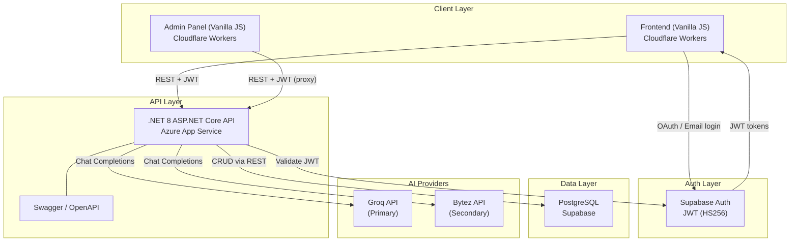

## System architecture diagram

<Frame caption="DualMind Lab system architecture — all communication is HTTP-based">

</Frame>

<Tip>
This diagram shows the complete system. Every arrow is an HTTP request — no WebSocket, no message queues, no background workers.
</Tip>

## Component interaction summary

| Component | Talks to | Protocol | Purpose |
|-----------|----------|----------|---------|
| Frontend | Backend API | HTTPS REST + SSE | All user actions: chat, vote, thread management |
| Frontend | Supabase Auth | HTTPS | User login/signup, obtain JWT |
| Admin Panel | Backend API | HTTPS REST (proxied via Worker) | CRUD operations on all entities |
| Backend API | Supabase/PostgreSQL | HTTPS (PostgREST) | Data persistence for all tables |
| Backend API | Groq | HTTPS | Primary AI chat completions |
| Backend API | Bytez | HTTPS | Secondary AI chat completions |
| Backend API | Supabase Auth | JWT validation | Verify user identity on each request |

## Repositories

<CardGroup cols={3}>
  <Card title="Backend API" icon="server" href="/architecture/backend">
    **DualMind_Back** — .NET 8 REST API with JWT auth, AI provider gateway, and Supabase data access
  </Card>
  <Card title="Frontend" icon="browser" href="/architecture/frontend">
    **DualMind UI** — Vanilla JS SPA with SSE streaming, served via Cloudflare Workers
  </Card>
  <Card title="Admin Panel" icon="gauge" href="/architecture/admin">
    **DualMind Admin UI** — Cloudflare Worker dashboard with full CRUD for all entities
  </Card>
</CardGroup>

## Backend architecture

The backend is a **.NET 8 ASP.NET Core Web API** located at `src/DualMind.API/`.

### Directory structure

<Tree>
  - src/DualMind.API/
    - AI/
      - Contracts/ — IChatProvider, ChatRequest, GroqResponse, AIStreamEvent
      - Gateway/ — ChatProviderFactory routes to correct provider
      - Providers/ — GroqService, BytezService implementations
    - Controllers/
      - Api/
        - ArenaController.cs — POST /api/arena/chat, /dualchat, /chat/stream
      - Admin/
        - AdminDashboardController.cs
        - AdminAIModelsController.cs
        - AdminUsersController.cs
        - AdminComparisonsController.cs
        - AdminModelVotesController.cs
        - AdminThreadsController.cs
        - AdminProvidersController.cs
      - ModelsController.cs — GET /api/models
      - ThreadsController.cs — CRUD /api/threads
      - UsersController.cs — POST /api/users/sync
      - SettingsController.cs — GET /api/settings/feature-flag/{key}
      - HealthController.cs — GET /health
      - SpeechController.cs — POST /api/speech/generate
    - Core/
      - Exceptions/ — ProviderExhaustedException
      - Models/ — User, AIModel, Comparison, ModelVote, Thread DTOs
      - Services/ — ModelSelector, ThreadsService, etc.
    - Infrastructure/
      - Configuration/ — EnvConfig, SupabaseSettings
      - Data/ — SupabaseService, AdminSupabaseClient
    - Program.cs — App bootstrap, DI registration, middleware
    - Dockerfile
</Tree>

### Key design patterns

- **<Tooltip tip="IChatProvider interface with GroqService and BytezService implementations">Provider abstraction</Tooltip>**: `ChatProviderFactory` routes requests to the correct provider based on model metadata.
- **Automatic fallback**: If a provider fails, the system falls back to Groq with `llama-3.3-70b-versatile`. If Groq fails, it tries an alternative Groq model.
- **<Tooltip tip="ProviderConfigService manages multiple API keys per provider with automatic rotation">Key rotation</Tooltip>**: Automatic rotation on auth errors, rate limits, and cooldowns.
- **<Tooltip tip="Prevents FK violations by ensuring public.users row exists before data writes">User sync</Tooltip>**: `UserSyncService.EnsureUserExistsAsync()` is called before any data-writing operation.

### Dependency injection (Program.cs)

```csharp filename="Program.cs"
// AI Providers — typed HttpClient to prevent socket exhaustion
builder.Services.AddHttpClient<GroqService>(c => c.Timeout = TimeSpan.FromSeconds(45));
builder.Services.AddHttpClient<BytezService>(c => c.Timeout = TimeSpan.FromSeconds(300));
builder.Services.AddScoped<IChatProviderFactory, ChatProviderFactory>();

// Core services
builder.Services.AddSingleton<IModelSelector, ModelSelector>();
builder.Services.AddScoped<IThreadsService, ThreadsService>();
builder.Services.AddScoped<IThreadMessagesService, ThreadMessagesService>();
builder.Services.AddScoped<IModelStatsService, ModelStatsService>();
builder.Services.AddScoped<ILeaderboardModelSelector, LeaderboardModelSelector>();
builder.Services.AddScoped<IComparisonLogger, ComparisonLogger>();
builder.Services.AddScoped<IMessageLogger, MessageLogger>();
builder.Services.AddScoped<IUserSyncService, UserSyncService>();
builder.Services.AddScoped<ISystemSettingsService, SystemSettingsService>();

// Data access
builder.Services.AddHttpClient<ISupabaseService, SupabaseService>();
builder.Services.AddHttpClient<IAdminSupabaseClient, AdminSupabaseClient>();
builder.Services.AddScoped<IProviderConfigService, ProviderConfigService>();
```

## Frontend architecture

The frontend is a **vanilla JavaScript** single-page application served via Cloudflare Workers.

### Directory structure

<Tree>
  - DualMind UI/
    - js/
      - api/
        - DualMindApi.js — Main API client facade
        - config/ApiConfig.js — Base URL, timeout configuration
        - core/HttpClient.js — Fetch wrapper with retry, auth headers
        - services/
          - ArenaService.js — chat(), dualChat(), streamChat()
          - ThreadService.js — CRUD threads and messages
          - ModelService.js — getModels()
          - UserService.js — syncUser()
      - app-final.js — Main application entry point
      - arena-core.js — Arena battle UI logic
    - components/
      - chat/ChatView.js — Chat message rendering
      - ChatInput.js — User input component
      - Header.js — Top navigation
      - ShareModal.js — Thread sharing dialog
    - css/ — Stylesheets
    - config.js — Global configuration (API URL, Supabase keys)
    - index.html — Main entry HTML
    - worker.js — Cloudflare Worker (serves static + proxies API)
    - wrangler.jsonc — Cloudflare deployment config
</Tree>

### Key patterns

- **API client facade**: `DualMindApi` class wraps all HTTP calls. Services like `ArenaService`, `ThreadService` encapsulate endpoint-specific logic.
- **SSE streaming**: Uses `fetch()` with `ReadableStream` (not `EventSource`) for streaming chat responses.
- **Auth flow**: Supabase JS client handles OAuth/email login. JWT stored in Supabase session, injected as `Authorization: Bearer` header on every API call.
- **Config-driven**: `window.DUALMIND_CONFIG` provides runtime configuration for API base URL, streaming settings, timeouts, and feature flags.

## Admin panel architecture

The admin panel is a separate **Cloudflare Workers** application.

<Tree>
  - DualMind Admin UI/
    - public/
      - js/
        - api/ — Admin API client
        - pages/ — Page-specific JS (users, models, etc.)
        - utils.js — Shared utilities
      - partials/
        - sidebar.html — Navigation sidebar
        - topbar.html — Top bar
      - index.html — Dashboard page
      - users.html — User management
      - models.html — Model management
      - comparisons.html — Comparison browser
      - config.js — API base URL config
      - auth-gate.js — Admin authentication check
    - worker.js — Cloudflare Worker entry point
    - wrangler.toml — Deployment config
    - package.json
</Tree>

### Admin worker proxy pattern

The admin Cloudflare Worker intercepts all requests:

1. **`/api/*` routes** are proxied to the backend (`BACKEND_URL` env var, default: `https://api.dualmindlab.tech`)
2. **Static files** are served from the `public/` directory via the `ASSETS` binding
3. **Extensionless paths** fall back to `.html` files (e.g., `/users` → `/users.html`)
4. **SPA fallback** returns `index.html` for unmatched routes

## Environment variables

<Tabs>
  <Tab title="Backend (.NET API)">
    | Variable | Required | Description |
    |----------|----------|-------------|
    | `SUPABASE_URL` | Yes | Supabase project URL (e.g., `https://xxx.supabase.co`) |
    | `SUPABASE_SERVICE_ROLE_KEY` | Yes | Service role key for server-side DB access |
    | `SUPABASE_KEY` | Fallback | Anon key (used if service role key not set) |
    | `JWT_SECRET` | Recommended | Supabase JWT secret for HS256 token validation |
    | `GROQ_API_KEY` | Optional | Groq API key (overrides database keys) |

    <Warning>The service role key bypasses Row Level Security. Never expose it in client-side code.</Warning>
  </Tab>
  <Tab title="Frontend">
    | Variable | Location | Description |
    |----------|----------|-------------|
    | `DUALMIND_CONFIG.supabase.url` | `config.js` | Supabase project URL |
    | `DUALMIND_CONFIG.supabase.anonKey` | `config.js` | Supabase anonymous key |
    | `DUALMIND_CONFIG.apiBaseUrl` | `config.js` | Backend API URL (auto-detected: localhost vs production) |

    <Note>The `apiBaseUrl` auto-detects: uses `http://localhost:5079` in development, production URL otherwise.</Note>
  </Tab>
  <Tab title="Admin Panel">
    | Variable | Location | Description |
    |----------|----------|-------------|
    | `BACKEND_URL` | Wrangler env | Backend API URL for proxy |

    Set via `wrangler.toml` or Cloudflare dashboard environment variables.
  </Tab>
</Tabs>

## Next steps

<CardGroup cols={2}>
  <Card title="Request Lifecycle" icon="arrows-spin" href="/architecture/request-lifecycle">
    Detailed execution flow from HTTP request to response
  </Card>
  <Card title="Backend Deep Dive" icon="server" href="/architecture/backend">
    Controllers, services, data access, and middleware pipeline
  </Card>
  <Card title="Data Flow Diagrams" icon="diagram-project" href="/architecture/data-flow">
    Mermaid diagrams for every major operation
  </Card>
  <Card title="Database Schema" icon="database" href="/database/schema">
    Complete table definitions and ER diagram
  </Card>
</CardGroup>
