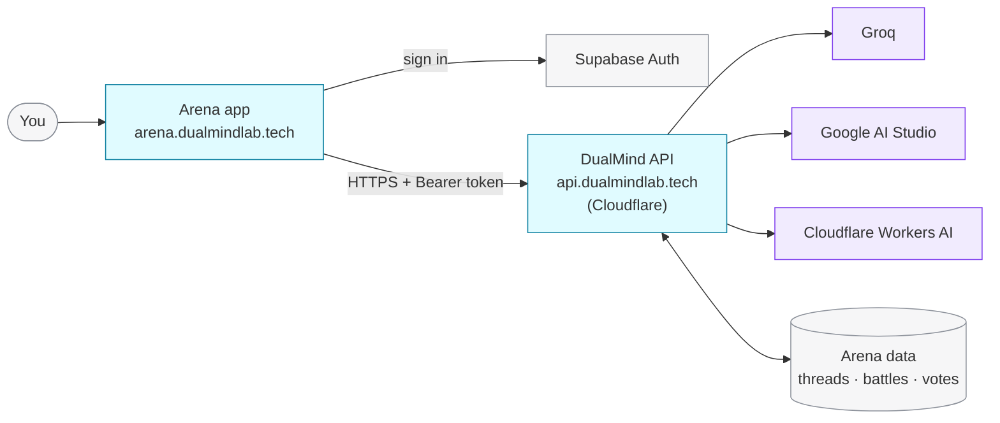
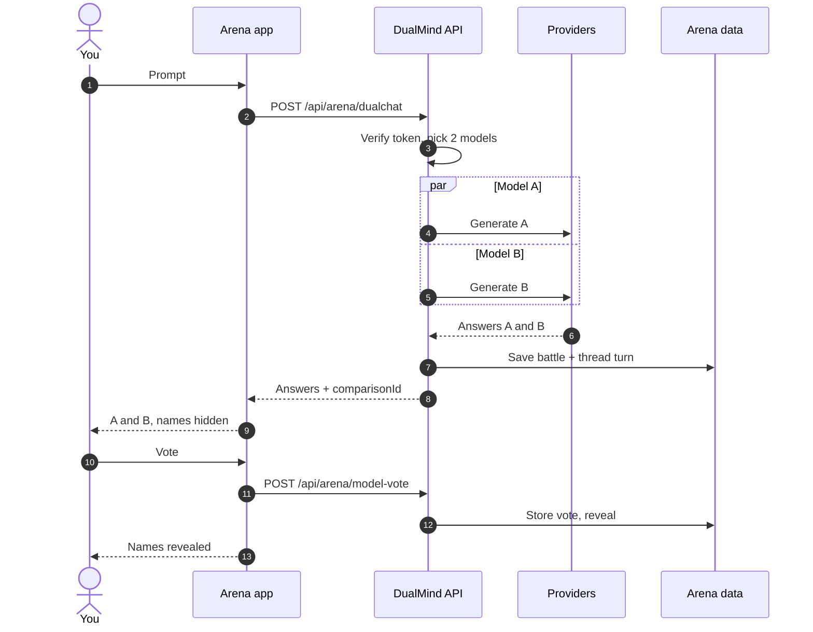

DualMind Arena is a web app backed by one REST API. The API picks models, calls the providers in parallel, stores the battle, and records votes that feed the leaderboard.

## The big picture

<CardGroup cols={2}>
  <Card title="Arena app" icon="app-window">
    A fast static web app served from Cloudflare's network. It handles sign-in, the battle UI, voting, threads and sharing.
  </Card>
  <Card title="DualMind API" icon="server">
    An ASP.NET Core service running in containers on Cloudflare, at `api.dualmindlab.tech`. Every Arena action goes through it.
  </Card>
  <Card title="Sign-in" icon="key-round">
    Accounts and sessions use Supabase Auth (email, phone, GitHub, Google). The API checks the session's access token on each request.
  </Card>
  <Card title="Model providers" icon="cpu">
    Groq, Google AI Studio and Cloudflare Workers AI. See [Models and providers](/concepts/models-and-providers).
  </Card>
</CardGroup>

## Life of a battle

<Steps>
  <Step title="Authenticate">
    The app sends your session's access token with each request. Battles, votes and private threads require it; the leaderboard, health check and shared threads don't.
  </Step>
  <Step title="Pick the models">
    Random, Topper or your own picks, depending on the [mode](/concepts/model-comparison).
  </Step>
  <Step title="Generate in parallel">
    Both models get the same prompt, system prompt, token limit and temperature, at the same time. Each call has a 60 second limit with an automatic [fallback](/concepts/models-and-providers#when-a-model-is-unavailable).
  </Step>
  <Step title="Store">
    The battle is stored as a comparison with its own ID, and the turn is added to your thread.
  </Step>
  <Step title="Vote and reveal">
    Your vote is stored once per battle, the battle is marked revealed, and the leaderboard stats pick it up.
  </Step>
</Steps>

## Built to stay up

<AccordionGroup>
  <Accordion title="Always warm" icon="flame">
    The API runs in containers on Cloudflare and is pinged every few minutes, so requests rarely hit a cold start.
  </Accordion>
  <Accordion title="Provider fallback" icon="life-buoy">
    If a provider errors or times out, the API answers with a fallback model and labels the reply, instead of failing the whole battle.
  </Accordion>
  <Accordion title="Health endpoint" icon="activity">
    [`GET /health`](/api-reference/utilities/health) reports whether the API is up. It's public, so you can point an uptime monitor at it.
  </Accordion>
</AccordionGroup>
