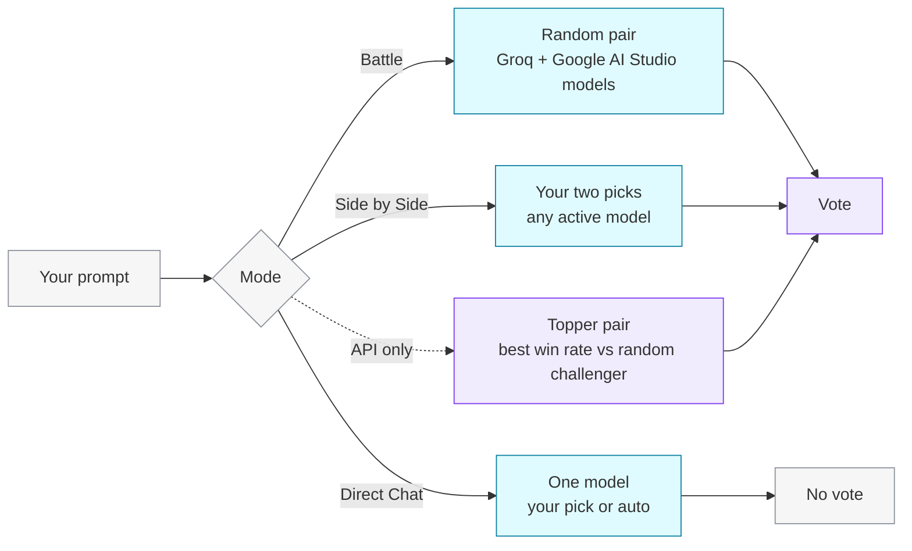

The mode menu at the top of the Arena switches between three modes. Battles and Side by Side comparisons can be voted on; Direct Chat is for trying one model on its own.

<CardGroup cols={3}>
  <Card title="Battle" icon="swords">
    Two **anonymous** models, picked for you. Vote, then see who they were.
  </Card>
  <Card title="Side by Side" icon="columns-2">
    **You pick** both models. Great for A/B tests.
  </Card>
  <Card title="Direct Chat" icon="message-circle">
    Talk to **one model**, yours or the Arena's pick.
  </Card>
</CardGroup>

## How models are paired

<Tabs>
  <Tab title="Battle" icon="swords">
    The Arena picks two **different** models at random from the auto-selectable pool, sends both the same prompt in parallel, and labels the answers **Model A** and **Model B**. Names are shown only after you vote.

    **Use it for:** unbiased discovery and the cleanest leaderboard signal.

    In the API this is `POST /api/arena/dualchat` with no `model1`/`model2` and `selectionMode: "random"` (the default).
  </Tab>
  <Tab title="Side by Side" icon="columns-2">
    Choose the left and right model yourself from the model list. Any active model can be used, including the Cloudflare Workers AI models that random battles skip.

    **Use it for:** comparing two specific models on your own prompts, checking a new release against an incumbent, or testing a language or domain you care about.

    In the API, set **both** `model1` and `model2`. Setting only one returns `400 INVALID_REQUEST`.
  </Tab>
  <Tab title="Direct Chat" icon="message-circle">
    A plain conversation with one model. Pick a model, or leave it on auto and the Arena chooses one for you. There is nothing to vote on.

    **Use it for:** exploring a model in depth before comparing it.

    In the API this is `POST /api/arena/chat` (or `/api/arena/chat/stream` for token-by-token output).
  </Tab>
  <Tab title="Topper (API)" icon="crown">
    `selectionMode: "topper"` pairs the model with the best current **win rate** against a random challenger. It is available through the API; the Arena UI uses random battles.

    **Use it for:** stress-testing the current leader.
  </Tab>
</Tabs>

## Choosing a good prompt

<AccordionGroup>
  <Accordion title="Make it discriminating" icon="target">
    "Say hello" gets near-identical answers from every model. Prompts that need reasoning, careful instruction following, or a specific format show real differences.
  </Accordion>
  <Accordion title="Add constraints" icon="list-checks">
    Ask for a word limit, a format (a table, JSON, a haiku), or something to avoid. Following constraints is a big part of quality.
  </Accordion>
  <Accordion title="Check facts" icon="search-check">
    For factual prompts, check both answers. A confident wrong answer should lose to a hesitant right one.
  </Accordion>
  <Accordion title="Judge content, not formatting" icon="type">
    Bold text and bullet points make an answer look organised. Ask whether it actually answers the question better.
  </Accordion>
</AccordionGroup>

<Info>
  If a model is unreachable or times out, the Arena answers with a fallback model and starts the reply with a **[System Note]** saying so. Keep that in mind before voting on that battle.
</Info>
