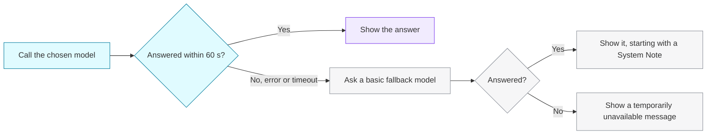

The Arena serves **50+ open and hosted models** from three inference providers. The live list is always available from [`GET /api/models`](/api-reference/models/list-models), and the [leaderboard](/concepts/leaderboard) shows how each one is doing.

<CardGroup cols={3}>
  <Card title="Groq" icon="zap">
    Fast hosted open models such as Llama 3.x and 4, Qwen 3, Kimi K2, GPT OSS and Groq Compound.
  </Card>
  <Card title="Google AI Studio" icon="sparkles">
    Gemini (2.0 and 2.5 Flash, Flash-Lite, Pro) and the Gemma 3 and 3n family.
  </Card>
  <Card title="Cloudflare Workers AI" icon="cloud">
    A wide catalogue of open models: Llama, Mistral, Qwen, DeepSeek R1 distills, Gemma, Granite and more.
  </Card>
</CardGroup>

<Note>
  The roster changes as models are added or retired. Treat these as examples and check `GET /api/models` for the current list.
</Note>

## Which models appear where

| Where | Groq | Google AI Studio | Cloudflare Workers AI |
| :-- | :-: | :-: | :-: |
| **Battle** (random pair) | ✅ | ✅ | — |
| **Side by Side** (you pick) | ✅ | ✅ | ✅ |
| **Direct Chat**, model chosen | ✅ | ✅ | ✅ |
| **Direct Chat**, auto | ✅ | ✅ | — |
| **Topper** pairing (API) | ✅ | ✅ | ✅ |

Cloudflare Workers AI models are **manual-only**: choose them in Side by Side or Direct Chat. Random picks come from Groq and Google AI Studio.

## Model identifiers

Each model has a `modelName` (the provider's identifier) and a `modelId` (a UUID). Either one works in the API's `model`, `model1` and `model2` fields.

<CodeGroup>
```json Groq
{ "modelName": "llama-3.3-70b-versatile", "displayName": "Llama 3.3 70B Versatile", "providerName": "groq" }
```

```json Google AI Studio
{ "modelName": "gemini-2.5-flash", "displayName": "Gemini 2.5 Flash", "providerName": "google" }
```

```json Cloudflare Workers AI
{ "modelName": "@cf/meta/llama-3.1-8b-instruct", "displayName": "llama-3.1-8b-instruct", "providerName": "cloudflare" }
```
</CodeGroup>

## Defaults

Unless you set them through the API, every request uses the same settings for both models, so neither gets an advantage:

| Setting | Default |
| :-- | :-- |
| `maxTokens` | 4096 |
| `temperature` | 0.7 |
| Timeout per model | 60 seconds |

## When a model is unavailable

Providers have outages and rate limits. Rather than failing the whole battle, the Arena falls back:



A fallback reply starts with a line like this, so you always know:

```text
[System Note]: The original model 'gemini-2.5-pro' was unreachable. Showing response from basic fallback model '...'.
```

<Tip>
  If one side of a battle shows a System Note, consider skipping the vote: you'd be judging the fallback model, not the one that was picked.
</Tip>
