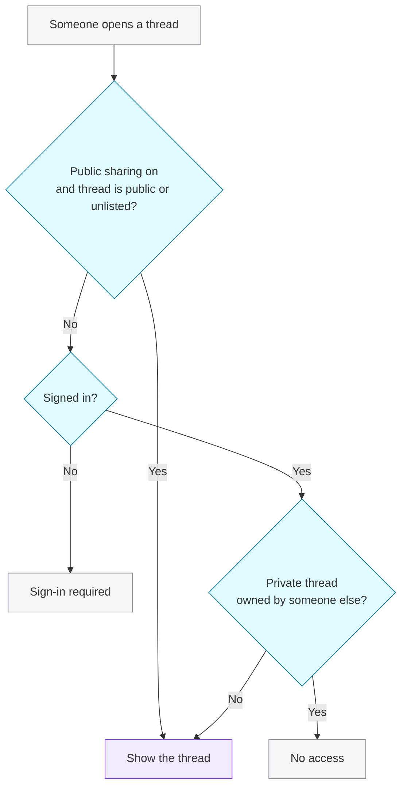

When you send your first prompt, the Arena creates a **thread** for the conversation and lists it in the sidebar. Every turn after that, battle or chat, is saved to the same thread with both answers, the models used, and your vote.

## Visibility

<CardGroup cols={3}>
  <Card title="Private" icon="lock">
    The default. Only you can open it.
  </Card>
  <Card title="Unlisted" icon="link">
    Anyone with the link can view it. It isn't listed anywhere.
  </Card>
  <Card title="Public" icon="globe">
    Anyone can view it. Meant for threads you're happy to have reshared.
  </Card>
</CardGroup>

## Share a thread

<Steps>
  <Step title="Open the share dialog">
    Open the thread and click the share button in the header.
  </Step>
  <Step title="Choose who can see it">
    Pick **Unlisted** or **Public**. Only the owner can change visibility.
  </Step>
  <Step title="Copy the link">
    Share links look like `https://arena.dualmindlab.tech/share/<thread-id>`. Viewers don't need an account while public sharing is enabled.
  </Step>
</Steps>

<Warning>
  A shared thread shows your prompts, both answers and the model names. Don't share threads that contain anything private.
</Warning>

## Access rules

Renaming, changing visibility and deleting a thread are always limited to its owner.

## Threads from code

| Task | Endpoint |
| :-- | :-- |
| List your threads | [`GET /api/threads`](/api-reference/threads/list-threads) |
| Create a thread | [`POST /api/threads`](/api-reference/threads/create-thread) |
| Read a thread / its messages | [`GET /api/threads/{threadId}`](/api-reference/threads/get-thread) · [`/messages`](/api-reference/threads/get-messages) |
| Rename | [`PATCH /api/threads/{threadId}`](/api-reference/threads/update-thread) |
| Share | [`PATCH /api/threads/{threadId}/visibility`](/api-reference/threads/share-thread) |
| Delete | [`DELETE /api/threads/{threadId}`](/api-reference/threads/delete-thread) |

Pass a `threadId` to [Start a battle](/api-reference/chat/dual-chat) or [Chat](/api-reference/chat/single-chat) to save that turn to the thread.
