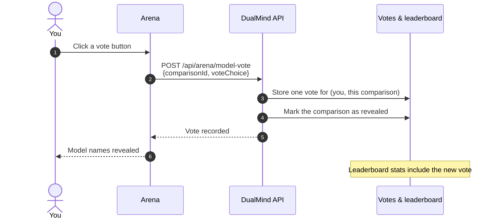

After both answers arrive, the Arena asks **Which response was better?** Your vote is the signal the whole leaderboard is built on.

## Vote options

| Button | API value | Meaning | Winner recorded |
| :-- | :-- | :-- | :-- |
| 👈 **Left is better** | `left` | Model A (left) gave the better answer | Left model |
| 👉 **Right is better** | `right` | Model B (right) gave the better answer | Right model |
| 🤝 **It's a tie** | `tie` | Both were good, and about equally so | None |
| 👎 **Both are bad** | `both-bad` | Neither answer was helpful | None |

<Tip>
  Use **Both are bad** honestly. It keeps two weak answers from being counted as a tie between good ones.
</Tip>

## What happens when you vote

<Steps>
  <Step title="One vote per battle">
    Each signed-in user gets one vote per comparison. A second vote on the same comparison is rejected, so votes can't be changed or stacked.
  </Step>
  <Step title="Reveal">
    The vote marks the comparison as revealed and the Arena shows which model was which. After a decisive vote the Arena highlights the winning answer; you can still expand the other one.
  </Step>
  <Step title="Ranking">
    The vote counts toward both models' wins, losses or ties and their ELO score on the [leaderboard](/concepts/leaderboard).
  </Step>
</Steps>

## Good voting habits

<CardGroup cols={2}>
  <Card title="Read both answers fully" icon="book-open-check">
    The first answer you read becomes an anchor. Give the second one the same attention.
  </Card>
  <Card title="Ignore speed" icon="timer-off">
    Both answers arrive together. How fast a model is says little about how good its answer is.
  </Card>
  <Card title="Watch for system notes" icon="triangle-alert">
    A reply that starts with **[System Note]** came from a fallback model because the original was unavailable.
  </Card>
  <Card title="Skip if unsure" icon="skip-forward">
    You don't have to vote. A thoughtful vote is worth more than a guess.
  </Card>
</CardGroup>

<Note>
  Voting from code? See [Submit a vote](/api-reference/voting/submit-vote) and the [Run a battle](/api-reference/guides/run-a-battle) tutorial.
</Note>
