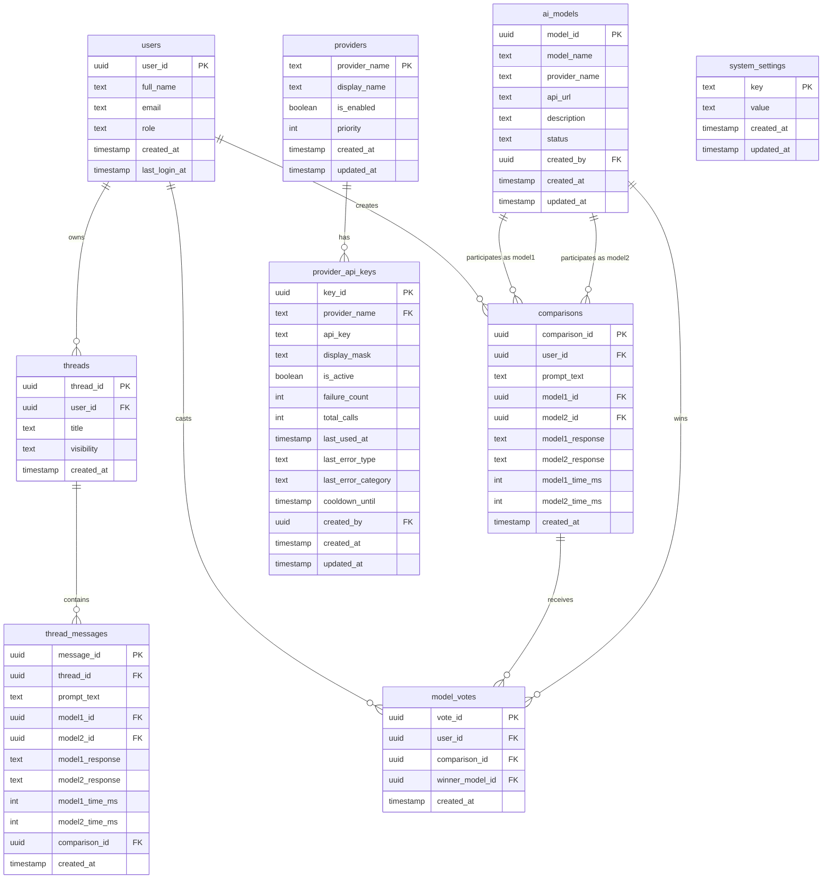

## Overview

DualMind Lab uses **PostgreSQL** hosted on **Supabase**. All tables live in the `public` schema. The backend accesses data via Supabase's PostgREST API (not an ORM).

<Info>
**9 tables** in the `public` schema. All primary keys are UUID v4. The backend uses the Supabase **service role key** (bypasses RLS).
</Info>

## Entity relationship diagram

## Table definitions

### `users`

Stores all registered users. Synced from Supabase Auth via `UserSyncService.EnsureUserExistsAsync()`.

| Column | Type | Nullable | Default | Description |
|--------|------|----------|---------|-------------|
| `user_id` | `uuid` | No | — | **Primary key**. Matches Supabase Auth `id` |
| `full_name` | `text` | Yes | — | Display name |
| `email` | `text` | Yes | — | Email address |
| `role` | `text` | Yes | `'user'` | Role: `user`, `admin` |
| `created_at` | `timestamptz` | Yes | `now()` | Account creation time |
| `last_login_at` | `timestamptz` | Yes | — | Last login timestamp |

### `ai_models`

Registry of all AI models available for comparison.

| Column | Type | Nullable | Default | Description |
|--------|------|----------|---------|-------------|
| `model_id` | `uuid` | No | `gen_random_uuid()` | **Primary key** |
| `model_name` | `text` | No | — | Model identifier (e.g., `llama-3.3-70b-versatile`) |
| `provider_name` | `text` | Yes | — | Provider name (e.g., `groq`, `bytez`) |
| `api_url` | `text` | Yes | — | API endpoint URL |
| `description` | `text` | Yes | — | Human-readable display name |
| `status` | `text` | Yes | `'active'` | Status: `active`, `inactive`, `deprecated` |
| `created_by` | `uuid` | Yes | — | FK to `users.user_id` |
| `created_at` | `timestamptz` | Yes | `now()` | Creation time |
| `updated_at` | `timestamptz` | Yes | — | Last update time |

### `threads`

Conversation threads owned by users.

| Column | Type | Nullable | Default | Description |
|--------|------|----------|---------|-------------|
| `thread_id` | `uuid` | No | `gen_random_uuid()` | **Primary key** |
| `user_id` | `uuid` | Yes | — | FK to `users.user_id` |
| `title` | `text` | Yes | — | Thread title |
| `visibility` | `text` | Yes | `'private'` | `private`, `public`, `unlisted` |
| `created_at` | `timestamptz` | Yes | `now()` | Creation time |

### `thread_messages`

Individual messages within a thread. Supports both single-model and dual-model responses.

| Column | Type | Nullable | Default | Description |
|--------|------|----------|---------|-------------|
| `message_id` | `uuid` | No | `gen_random_uuid()` | **Primary key** |
| `thread_id` | `uuid` | No | — | FK to `threads.thread_id` |
| `prompt_text` | `text` | Yes | — | User's prompt |
| `model1_id` | `uuid` | Yes | — | FK to `ai_models.model_id` (or model name stored) |
| `model2_id` | `uuid` | Yes | — | FK to `ai_models.model_id` (null for single chat) |
| `model1_response` | `text` | Yes | — | Response from model 1 |
| `model2_response` | `text` | Yes | — | Response from model 2 (null for single chat) |
| `model1_time_ms` | `integer` | Yes | — | Response time for model 1 |
| `model2_time_ms` | `integer` | Yes | — | Response time for model 2 |
| `comparison_id` | `uuid` | Yes | — | FK to `comparisons.comparison_id` |
| `created_at` | `timestamptz` | Yes | `now()` | Message timestamp |

### `comparisons`

Records of dual-chat arena comparisons.

| Column | Type | Nullable | Default | Description |
|--------|------|----------|---------|-------------|
| `comparison_id` | `uuid` | No | `gen_random_uuid()` | **Primary key** |
| `user_id` | `uuid` | Yes | — | FK to `users.user_id` |
| `prompt_text` | `text` | Yes | — | The prompt sent to both models |
| `model1_id` | `uuid` | Yes | — | FK to `ai_models.model_id` |
| `model2_id` | `uuid` | Yes | — | FK to `ai_models.model_id` |
| `model1_response` | `text` | Yes | — | Full response from model 1 |
| `model2_response` | `text` | Yes | — | Full response from model 2 |
| `model1_time_ms` | `integer` | Yes | — | Response time (ms) for model 1 |
| `model2_time_ms` | `integer` | Yes | — | Response time (ms) for model 2 |
| `created_at` | `timestamptz` | Yes | `now()` | Comparison timestamp |

### `model_votes`

User votes on comparison outcomes.

| Column | Type | Nullable | Default | Description |
|--------|------|----------|---------|-------------|
| `vote_id` | `uuid` | No | `gen_random_uuid()` | **Primary key** |
| `user_id` | `uuid` | Yes | — | FK to `users.user_id` |
| `comparison_id` | `uuid` | Yes | — | FK to `comparisons.comparison_id` |
| `winner_model_id` | `uuid` | Yes | — | FK to `ai_models.model_id` |
| `created_at` | `timestamptz` | Yes | `now()` | Vote timestamp |

### `providers`

AI provider registry (Groq, Bytez, etc.).

| Column | Type | Nullable | Default | Description |
|--------|------|----------|---------|-------------|
| `provider_name` | `text` | No | — | **Primary key** (e.g., `groq`) |
| `display_name` | `text` | Yes | — | Human-readable name |
| `is_enabled` | `boolean` | No | `true` | Whether provider is active |
| `priority` | `integer` | No | `0` | Selection priority (higher = preferred) |
| `created_at` | `timestamptz` | Yes | `now()` | Creation time |
| `updated_at` | `timestamptz` | Yes | — | Last update time |

### `provider_api_keys`

API keys for each provider with rotation and health tracking.

| Column | Type | Nullable | Default | Description |
|--------|------|----------|---------|-------------|
| `key_id` | `uuid` | No | `gen_random_uuid()` | **Primary key** |
| `provider_name` | `text` | No | — | FK to `providers.provider_name` |
| `api_key` | `text` | No | — | Encrypted API key |
| `display_mask` | `text` | Yes | — | Masked key for display (e.g., `sk-...abc`) |
| `is_active` | `boolean` | No | `true` | Whether key is active |
| `failure_count` | `integer` | No | `0` | Consecutive failure count |
| `total_calls` | `integer` | No | `0` | Total API calls made with this key |
| `last_used_at` | `timestamptz` | Yes | — | Last successful use |
| `last_error_type` | `text` | Yes | — | Last error classification |
| `last_error_category` | `text` | Yes | — | Error category |
| `cooldown_until` | `timestamptz` | Yes | — | Key is in cooldown until this time |
| `created_by` | `uuid` | Yes | — | FK to `users.user_id` |
| `created_at` | `timestamptz` | Yes | `now()` | Creation time |
| `updated_at` | `timestamptz` | Yes | — | Last update time |

### `system_settings`

Key-value store for system configuration and feature flags.

| Column | Type | Nullable | Default | Description |
|--------|------|----------|---------|-------------|
| `key` | `text` | No | — | **Primary key** (e.g., `public_sharing`) |
| `value` | `text` | Yes | — | Setting value (e.g., `true`) |
| `created_at` | `timestamptz` | Yes | `now()` | Creation time |
| `updated_at` | `timestamptz` | Yes | — | Last update time |

## Key relationships

- `threads.user_id` → `users.user_id` (thread ownership)
- `thread_messages.thread_id` → `threads.thread_id` (message belongs to thread)
- `comparisons.user_id` → `users.user_id` (who created the comparison)
- `comparisons.model1_id` / `model2_id` → `ai_models.model_id`
- `model_votes.comparison_id` → `comparisons.comparison_id`
- `model_votes.winner_model_id` → `ai_models.model_id`
- `provider_api_keys.provider_name` → `providers.provider_name`

<Warning>
The `UserSyncService.EnsureUserExistsAsync()` pattern exists because Supabase Auth creates users in `auth.users` but not in `public.users`. The backend must insert the `public.users` row before any operation that references `user_id` as a foreign key.
</Warning>
