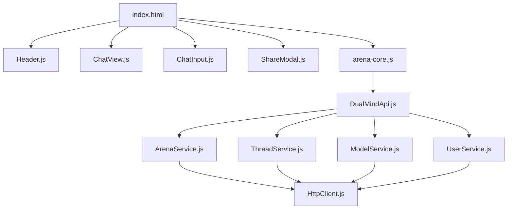

## Component hierarchy

## API service layer

### ArenaService

Located at `js/api/services/ArenaService.js`. Handles all chat and arena operations.

| Method | HTTP | Endpoint | Description |
|--------|------|----------|-------------|
| `chat(request)` | POST | `/api/arena/chat` | Single model chat |
| `dualChat(request)` | POST | `/api/arena/dualchat` | Dual model comparison |
| `streamChat(request, onChunk)` | POST | `/api/arena/chat/stream` | SSE streaming chat |
| `vote(data)` | POST | `/api/votes/model-vote` | Submit vote |
| `getStats()` | GET | `/api/votes/model-stats` | Get leaderboard |

### ThreadService

Located at `js/api/services/ThreadService.js`.

| Method | HTTP | Endpoint | Description |
|--------|------|----------|-------------|
| `getThreads(limit)` | GET | `/api/threads` | List user threads |
| `createThread(data)` | POST | `/api/threads` | Create thread |
| `getThread(id)` | GET | `/api/threads/{id}` | Get single thread |
| `getMessages(id)` | GET | `/api/threads/{id}/messages` | Get thread messages |
| `updateThread(id, data)` | PATCH | `/api/threads/{id}` | Update title |
| `updateVisibility(id, data)` | PATCH | `/api/threads/{id}/visibility` | Change visibility |
| `deleteThread(id)` | DELETE | `/api/threads/{id}` | Delete thread |

### ModelService

Located at `js/api/services/ModelService.js`.

| Method | HTTP | Endpoint | Description |
|--------|------|----------|-------------|
| `getModels()` | GET | `/api/models` | List active AI models |

### UserService

Located at `js/api/services/UserService.js`.

| Method | HTTP | Endpoint | Description |
|--------|------|----------|-------------|
| `syncUser(data)` | POST | `/api/users/sync` | Sync user to backend |

## UI components

### ChatView (`components/chat/ChatView.js`)

Renders chat messages with markdown support and auto-scrolling. Handles both single and dual-chat message layouts.

### ChatInput (`components/ChatInput.js`)

Text input with auto-resize textarea. Key behaviors:
- Auto-grows up to `maxTextareaHeight` (180px default)
- Enter to send, Shift+Enter for newline
- Configurable via `window.DUALMIND_CONFIG.ui`

### ShareModal (`components/ShareModal.js`)

Dialog for sharing threads. Changes thread visibility to `public` or `unlisted` and generates a shareable URL.

### Header (`components/Header.js`)

Top navigation bar with user avatar, theme toggle, and navigation links.

## HttpClient (`js/api/core/HttpClient.js`)

Central fetch wrapper that handles:
- **Auth headers**: Automatically injects `Authorization: Bearer <jwt>` from Supabase session
- **Retry logic**: Configurable retry attempts with exponential backoff
- **Timeout**: Default 30s, configurable via `DUALMIND_CONFIG.api.timeout`
- **Error handling**: Throws structured errors with status code and response body
- **Base URL**: Resolves from `DUALMIND_CONFIG.apiBaseUrl`
