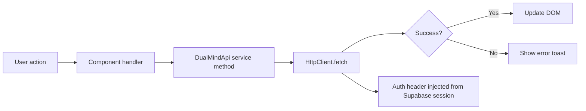

## State architecture

DualMind Lab frontend uses **no state management library**. State is managed through:

1. **`window.DUALMIND_CONFIG`** — global runtime configuration
2. **Supabase session** — authentication state in localStorage
3. **DOM state** — UI state lives in the DOM
4. **In-memory caches** — API responses cached with TTL

## Global configuration state

All configuration is set once in `config.js` and accessed via `window.DUALMIND_CONFIG`:

```javascript filename="config.js usage"
// Reading config anywhere in the app
const baseUrl = window.DUALMIND_CONFIG.apiBaseUrl;
const isStreaming = window.DUALMIND_CONFIG.features.streaming;
const timeout = window.DUALMIND_CONFIG.api.timeout;
```

### Configuration categories

| Namespace | Purpose | Example values |
|-----------|---------|----------------|
| `apiBaseUrl` | Backend URL | `https://api.dualmindlab.tech` |
| `supabase.*` | Supabase credentials | `url`, `anonKey` |
| `streaming.*` | SSE behavior | `enabled`, `chunkDelay: 50` |
| `api.*` | HTTP settings | `timeout: 30000`, `retryAttempts: 2` |
| `models.*` | Model defaults | `defaultModel`, `maxTokens: 4096` |
| `ui.*` | UI behavior | `autoResizeTextarea`, `scrollBehavior` |
| `cache.*` | Cache TTLs | `leaderboardExpiry: 300000` |
| `features.*` | Feature flags | `streaming`, `voting`, `threads` |

## Authentication state

Managed entirely by the Supabase JS client. The session is stored in `localStorage` and includes:

- `access_token` — JWT for API calls
- `refresh_token` — for token renewal
- `user` — user profile (id, email, name)

```javascript filename="Auth state check"
// Check auth state
const { data: { session } } = await supabase.auth.getSession();
if (session) {
    const jwt = session.access_token;
    const userId = session.user.id;
}

// Listen for auth changes
supabase.auth.onAuthStateChange((event, session) => {
    if (event === 'SIGNED_IN') { /* redirect to main app */ }
    if (event === 'SIGNED_OUT') { /* redirect to login */ }
});
```

## Caching strategy

The frontend caches certain API responses in memory with configurable TTLs:

| Data | Cache key | Default TTL | Invalidation |
|------|-----------|-------------|--------------|
| Leaderboard stats | In-memory | 5 minutes | Manual refresh |
| Model list | In-memory | 1 hour | Page reload |
| Thread list | In-memory | 30 minutes | On thread create/delete |

## Data flow pattern



There is no centralized store. Each page manages its own state through direct DOM manipulation and API calls.
