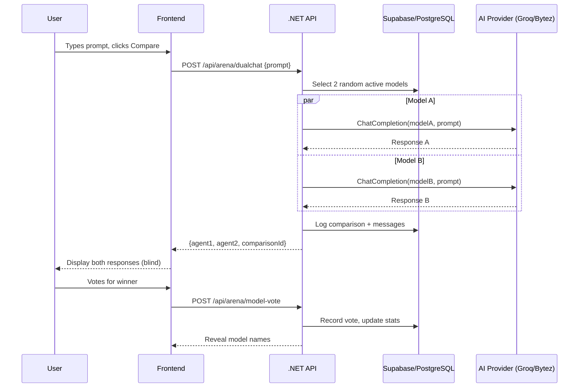

## What is DualMind Lab? <Badge>v2.0</Badge>

DualMind Lab is an **AI model comparison platform** that allows users to compare two or more AI models side-by-side with random or blind selection, vote on which response is better, and track model performance on a community-driven <Tooltip tip="Elo rating system adapted from chess for ranking AI models based on pairwise comparisons">ELO-based leaderboard</Tooltip>.

<Info>
**Blind comparison** eliminates brand bias — users don't see which model generated which response until after voting.
</Info>

<CardGroup cols={2}>
  <Card title="Dual-Chat Arena" icon="messages">
    Send one prompt to two randomly selected AI models and compare responses side-by-side in a blind test
  </Card>
  <Card title="Community Voting" icon="ranking-star">
    Vote for the better response. Votes feed into an ELO-based leaderboard that ranks model performance
  </Card>
  <Card title="Thread Management" icon="folder-open">
    Persistent conversation threads with visibility controls (private, public, unlisted) and sharing
  </Card>
  <Card title="Multi-Provider AI" icon="plug">
    Groq and Bytez providers with automatic key rotation, failover, and fallback logic built in
  </Card>
</CardGroup>

## Technology stack

<Tabs>
  <Tab title="Overview">
    | Layer | Technology | Details |
    |-------|-----------|---------|
    | **Backend** | .NET 8 / C# / ASP.NET Core | REST API with Swagger, hosted on Azure |
    | **Database** | PostgreSQL via Supabase | All data: users, threads, comparisons, votes, models |
    | **Auth** | Supabase Auth + JWT | HS256 tokens, `sub` claim = user ID |
    | **Frontend** | Vanilla JS + HTML/CSS | Served via Cloudflare Workers, SSE streaming |
    | **Admin Panel** | Vanilla JS + Cloudflare Workers | Proxies `/api/*` to backend, serves static HTML |
    | **AI Providers** | Groq, Bytez | OpenAI-compatible chat completions API |
  </Tab>
  <Tab title="Backend">
    - **Runtime**: .NET 8.0 (ASP.NET Core)
    - **Language**: C# with async/await throughout
    - **Auth**: JWT Bearer validation (HS256, Supabase-issued)
    - **Data access**: Direct HTTP to Supabase PostgREST (no ORM)
    - **AI gateway**: `IChatProvider` abstraction with `GroqService` and `BytezService`
    - **Hosting**: Azure App Service

    <Tip>
    The backend uses `Task.WhenAll()` for parallel dual-chat execution — both models run simultaneously.
    </Tip>
  </Tab>
  <Tab title="Frontend">
    - **Framework**: None — vanilla JavaScript ES6+
    - **Styling**: Custom CSS with responsive design
    - **Auth**: Supabase JS SDK (`@supabase/supabase-js`)
    - **Streaming**: `fetch()` with `ReadableStream` for SSE
    - **Hosting**: Cloudflare Workers (static asset serving + API proxy)

    <Note>
    The Cloudflare Worker proxies `/api/*` requests to the backend, avoiding CORS issues entirely.
    </Note>
  </Tab>
  <Tab title="Database">
    - **Engine**: PostgreSQL 15 (Supabase-managed)
    - **Tables**: `users`, `threads`, `thread_messages`, `comparisons`, `model_votes`, `ai_models`, `providers`, `provider_api_keys`, `system_settings`
    - **Access**: Service role key (bypasses RLS)
    - **IDs**: UUID v4 for all primary keys
  </Tab>
</Tabs>

## How it works



## Quick links

<CardGroup cols={2}>
  <Card title="Quickstart" icon="rocket" href="/quickstart">
    Clone repos, configure environment, run locally in under 15 minutes
  </Card>
  <Card title="Architecture Overview" icon="diagram-project" href="/architecture/overview">
    System diagrams, component interactions, and technology breakdown
  </Card>
  <Card title="API Reference" icon="code" href="/api-reference/chat/single-chat">
    All endpoints with interactive playground and multi-language examples
  </Card>
  <Card title="Database Schema" icon="database" href="/database/schema">
    Complete table definitions, ER diagrams, and relationships
  </Card>
</CardGroup>

## Repository structure

DualMind Lab is a **multi-repo project** with three main repositories:

<CardGroup cols={3}>
  <Card title="Backend API" icon="server" href="/architecture/backend">
    **DualMind_Back** — .NET 8 REST API with JWT auth, AI provider gateway, and Supabase data access
  </Card>
  <Card title="Frontend" icon="browser" href="/architecture/frontend">
    **DualMind UI** — Vanilla JS SPA with SSE streaming, served via Cloudflare Workers
  </Card>
  <Card title="Admin Panel" icon="gauge" href="/architecture/admin">
    **DualMind Admin UI** — Cloudflare Worker dashboard with full CRUD for all entities
  </Card>
</CardGroup>

## Authentication

All API endpoints (except health checks and feature flags) require a Supabase JWT token:

```bash filename="Authorization Header"
Authorization: Bearer <SUPABASE_JWT_TOKEN>
```

<AccordionGroup>
  <Accordion title="How to get a JWT token" icon="key">
    1. Sign in via the frontend using **Google OAuth** or email/password
    2. Supabase Auth issues a JWT with `sub` (user UUID), `email`, and `aud: "authenticated"`
    3. The frontend stores the token via `supabase.auth.getSession()`
    4. All API requests include the token in the `Authorization: Bearer` header

    ```javascript filename="frontend/js/api-client.js"
    const { data: { session } } = await supabase.auth.getSession();
    const token = session?.access_token;

    const response = await fetch('/api/arena/chat', {
      headers: { 'Authorization': `Bearer ${token}` }
    });
    ```
  </Accordion>
  <Accordion title="JWT validation in the backend" icon="shield-check">
    The backend validates every JWT using HS256 with the Supabase project's JWT secret:

    ```csharp filename="Program.cs"
    builder.Services.AddAuthentication(JwtBearerDefaults.AuthenticationScheme)
        .AddJwtBearer(options => {
            options.TokenValidationParameters = new TokenValidationParameters {
                ValidateIssuer = true,
                ValidIssuer = $"{supabaseUrl}/auth/v1",
                ValidateAudience = true,
                ValidAudience = "authenticated",
                ValidateLifetime = true,
                IssuerSigningKey = new SymmetricSecurityKey(
                    Encoding.UTF8.GetBytes(jwtSecret))
            };
        });
    ```

    <Warning>
    The JWT secret must match your Supabase project exactly. Find it in **Supabase Dashboard > Settings > API > JWT Secret**.
    </Warning>
  </Accordion>
</AccordionGroup>

## Explore the docs

<Tip>
Press <kbd>Cmd</kbd> + <kbd>C</kbd> (<kbd>Ctrl</kbd> + <kbd>C</kbd> on Windows) on any page to copy it as Markdown for AI tools. Or use the contextual menu to send pages directly to ChatGPT, Claude, or Perplexity.
</Tip>

<Check>Ready to start? Head to the [Quickstart guide](/quickstart), explore the [Architecture](/architecture/overview), or jump to the [API Reference](/api-reference/introduction).</Check>
