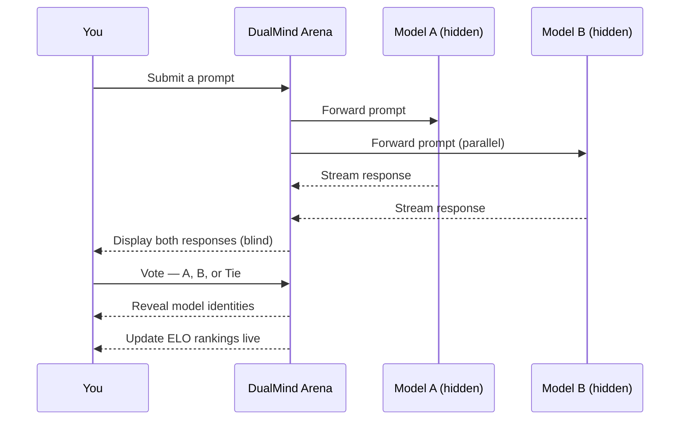

## What is DualMind Arena? <Badge>v2.0</Badge>

DualMind Arena is a **blind AI model comparison platform** — submit a prompt, receive responses from two competing models simultaneously, vote on the better one, and contribute to a community-driven <Tooltip tip="ELO rating — the same system used in chess. A model gains points by beating high-ranked opponents and loses points against lower-ranked ones.">ELO-based leaderboard</Tooltip>.

The key insight: **knowing a model's name changes how you judge it.** DualMind hides model identities until after you vote — so quality determines the ranking, not brand recognition.

<CardGroup cols={2}>
  <Card title="Arena Battle Mode" icon="swords" color="#0EA5E9">
    Submit one prompt to two AI models simultaneously. Vote blind. See the truth.
  </Card>
  <Card title="ELO Leaderboard" icon="ranking-star" color="#8B5CF6">
    Every vote shifts real ELO ratings. The leaderboard reflects collective human preference, not marketing budgets.
  </Card>
  <Card title="Conversation Threads" icon="folder-open" color="#10B981">
    Organize comparisons into persistent threads. Share publicly, keep private, or distribute via link.
  </Card>
  <Card title="Live Latency Metrics" icon="gauge-high" color="#F59E0B">
    Time to First Token and Tokens/Second tracked for every response. Speed is measured separately — never folded into quality.
  </Card>
</CardGroup>

---

## How it works

---

## Platform modes

<Tabs>
  <Tab title="⚔️ Arena Battle">
    Two randomly-selected models. One prompt. Zero brand bias.

    Responses appear side-by-side under anonymous labels — **Model A** and **Model B**. Vote for the better response, then see which models you were actually comparing.

    This is the primary mode for leaderboard contributions. Every vote carries statistical weight in the ELO system.
  </Tab>
  <Tab title="💬 Single Chat">
    Direct conversation with a specific model of your choice.

    Useful when you want to evaluate a known model in depth, test specific capabilities, or have a sustained conversation without the comparison framing.
  </Tab>
  <Tab title="📂 Threaded Conversations">
    Organize your comparisons into named threads with full history.

    - **Private** — visible only to you
    - **Unlisted** — accessible via link, not listed publicly
    - **Public** — discoverable by anyone

    Perfect for research documentation, sharing interesting comparisons, or building a personal evaluation archive.
  </Tab>
</Tabs>

---

## What makes this different

<AccordionGroup>
  <Accordion title="Why blind testing?" icon="eye-slash">
    In every study on AI evaluation, knowing a model's identity introduces measurable bias. Users consistently rate GPT-4 responses higher when they know it's GPT-4 — even when the content is identical to a competitor's output.

    Blind testing removes this entirely at the architecture level. Model names are never sent to the client until after a vote is submitted. This is enforced as a data contract, not a UI convention.
  </Accordion>
  <Accordion title="Why ELO instead of win rate?" icon="chart-line">
    Win rate is a static snapshot. A model with a 60% win rate against weak opponents tells you nothing about how it performs against the best.

    ELO is dynamic. It adjusts based on the strength of who you beat. A model that defeats high-ranked competitors gains more points than one that beats weak ones. This produces a leaderboard that reflects true relative quality, not raw vote counts.
  </Accordion>
  <Accordion title="Why measure latency separately?" icon="clock">
    A faster model response creates an immediate impression of fluency, even before the user reads a word. This is well-documented in UX research.

    Latency is infrastructure — it reflects hosting, not intelligence. The Arena displays Time to First Token (TTFT) and Tokens per Second (TPS) as separate, transparent metrics — never folded into a quality score.
  </Accordion>
</AccordionGroup>

---

## Start here

<CardGroup cols={2}>
  <Card title="Quickstart" icon="rocket" href="/quickstart" color="#0EA5E9">
    Run your first comparison in under two minutes.
  </Card>
  <Card title="How DualMind Works" icon="lightbulb" href="/concepts/how-dualmind-works" color="#8B5CF6">
    Deep dive into blind comparison, ELO scoring, and streaming architecture.
  </Card>
  <Card title="Evaluation Philosophy" icon="scale-balanced" href="/concepts/evaluation-philosophy" color="#10B981">
    The reasoning behind how we design fair, meaningful AI comparisons.
  </Card>
  <Card title="Roadmap" icon="map" href="/roadmap" color="#F59E0B">
    What we're building next and why.
  </Card>
</CardGroup>

<Check>Ready? Head to the [Quickstart guide](/quickstart) and run your first comparison.</Check>
