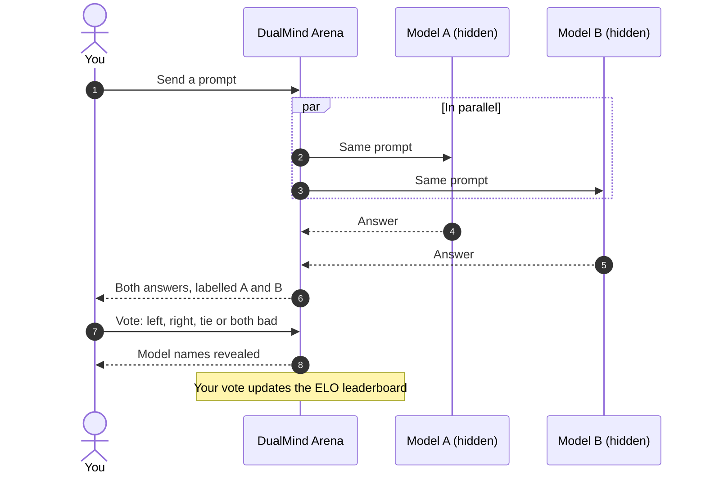

  DualMind Arena · Documentation
  <h1 className="dm-hero-title">Benchmarks are broken.Human judgment isn't.</h1>
  

    Two anonymous models answer the same prompt. You pick the better one, call a tie, or mark both bad.
    Names appear after your vote, and every vote feeds a live ELO leaderboard.
  

  

    <a className="dm-btn dm-btn-primary" href="/quickstart">Your first battle →</a>
    <a className="dm-btn dm-btn-ghost" href="/api-reference/introduction">Explore the API</a>
  

  

    <strong>50+</strong> models
    <strong>3</strong> providers
    <strong>3</strong> arena modes
    <strong>1</strong> live leaderboard
  

<h2 className="dm-h2">Start here</h2>

<CardGroup cols={3}>
  <Card title="Quickstart" icon="rocket" href="/quickstart">
    Sign in, send a prompt, vote. About two minutes.
  </Card>
  <Card title="Arena modes" icon="swords" href="/concepts/model-comparison">
    Battle, Side by Side and Direct Chat, and when to use each.
  </Card>
  <Card title="API reference" icon="code" href="/api-reference/introduction">
    The same REST API the Arena uses, with cURL, JavaScript and Python examples.
  </Card>
</CardGroup>

<h2 className="dm-h2">How a battle works</h2>

<h2 className="dm-h2">Explore</h2>

<CardGroup cols={2}>
  <Card title="Voting" icon="vote" href="/concepts/voting">
    The four vote options and what happens after you vote.
  </Card>
  <Card title="Leaderboard" icon="trophy" href="/concepts/leaderboard">
    How ELO ranks models, and how to read the numbers.
  </Card>
  <Card title="Threads and sharing" icon="messages-square" href="/concepts/threads">
    Keep battles in threads and share them with a link.
  </Card>
  <Card title="Models and providers" icon="cpu" href="/concepts/models-and-providers">
    Which models you can battle, from Groq, Google AI Studio and Cloudflare Workers AI.
  </Card>
  <Card title="Run a battle from code" icon="terminal" href="/api-reference/guides/run-a-battle">
    Start a battle, hide the names, vote, reveal. End to end.
  </Card>
  <Card title="What's new" icon="sparkles" href="/changelog">
    The API moved to Cloudflare, new providers, and more.
  </Card>
</CardGroup>

<h2 className="dm-h2">Why blind?</h2>

<AccordionGroup>
  <Accordion title="Names change how you judge" icon="eye-off">
    When you know which model wrote an answer, brand reputation leaks into your judgment. The Arena labels
    answers A and B and shows the names only after you vote, so the answer is judged on its own.
  </Accordion>
  <Accordion title="ELO beats a raw win rate" icon="chart-line">
    Beating a strong model counts for more than beating a weak one. ELO adjusts for opponent strength, so
    the leaderboard reflects relative quality, not just who played the most easy matches.
  </Accordion>
  <Accordion title="Speed is shown, not scored" icon="timer">
    Both models run in parallel and their answers appear together, so neither gets a head start. Response
    time is recorded separately and never folded into the ranking.
  </Accordion>
</AccordionGroup>

<Note>
  Questions or feedback? Write to [support@dualmindlab.tech](mailto:support@dualmindlab.tech) or see the [FAQ](/faq).
</Note>
