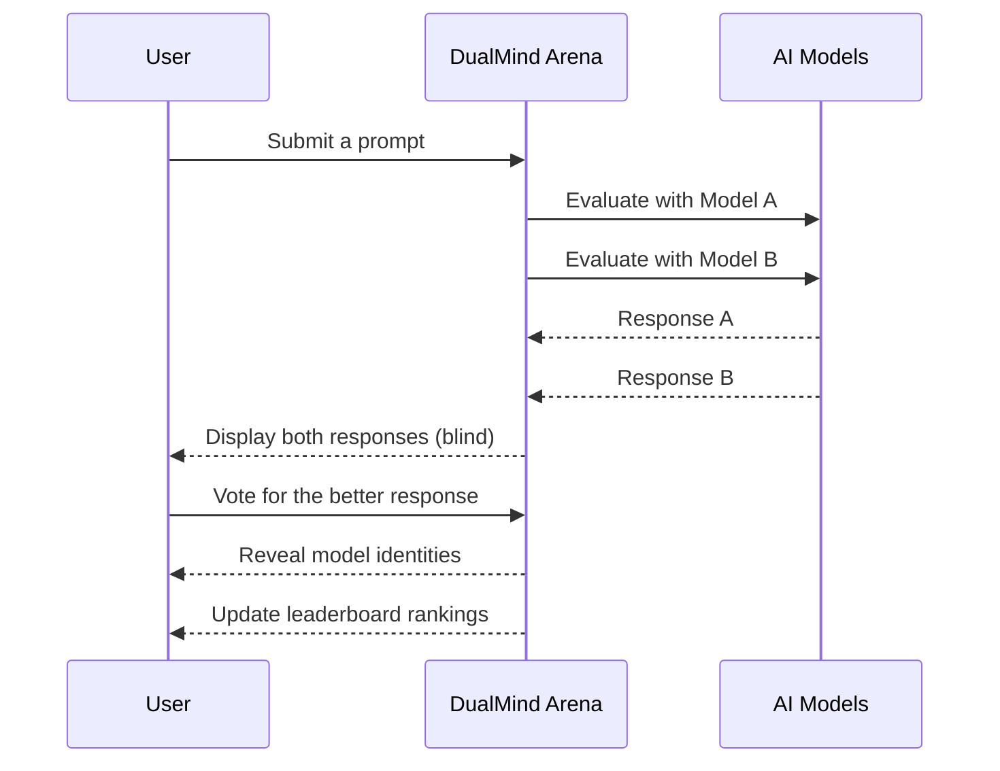

## What is DualMind Arena? <Badge>v2.0</Badge>

DualMind Arena is a **blind AI model comparison platform** that lets you evaluate leading AI models side-by-side — without brand bias. Submit a prompt, receive responses from two competing models simultaneously, vote on which response is superior, and contribute to a community-driven <Tooltip tip="Elo rating system adapted from chess for ranking AI models based on pairwise comparisons">ELO-based leaderboard</Tooltip>.

<Info>
**Blind comparison** eliminates brand bias — model identities are hidden until after you vote, ensuring quality drives every ranking.
</Info>

<CardGroup cols={2}>
  <Card title="Arena Battle Mode" icon="swords">
    Submit one prompt to two AI models simultaneously and compare their responses in a fully blind, unbiased test
  </Card>
  <Card title="Community Leaderboard" icon="ranking-star">
    Every vote contributes to an ELO-based ranking system that reflects real-world model quality
  </Card>
  <Card title="Conversation Threads" icon="folder-open">
    Persist your comparisons in organized threads with flexible sharing — private, public, or link-only
  </Card>
  <Card title="Multi-Model Support" icon="brain">
    Access a curated roster of leading AI models, with new additions rolled out continuously
  </Card>
</CardGroup>

## How it works



## Platform modes

<Tabs>
  <Tab title="Arena Battle">
    Send one prompt to two randomly selected AI models. Responses appear side-by-side under anonymous labels. Vote for the better response — then see which models you were comparing.

    **Best for**: Unbiased quality benchmarking, leaderboard contributions, discovering which models excel at specific tasks.
  </Tab>
  <Tab title="Single Chat">
    Chat with a specific AI model directly. Useful for targeted testing or building with a known model.

    **Best for**: Focused evaluation of a particular model, real-time streaming responses, conversational workflows.
  </Tab>
  <Tab title="Threaded Conversations">
    Organize your prompts and comparisons into persistent threads. Share publicly, keep private, or distribute via link.

    **Best for**: Documenting research, sharing interesting comparisons with colleagues, building a personal comparison archive.
  </Tab>
</Tabs>

## Authentication

API access requires a valid authentication token obtained through the DualMind platform:

```bash
Authorization: Bearer <your_token>
```

<AccordionGroup>
  <Accordion title="Getting started with the API" icon="key">
    1. Create an account at [arena.dualmindlab.tech](https://arena.dualmindlab.tech)
    2. Sign in using Google OAuth or email
    3. Your session token is automatically obtained by the platform
    4. For programmatic access, refer to the [API Reference](/api-reference/introduction)
  </Accordion>
  <Accordion title="Token validity" icon="shield-check">
    Authentication tokens are short-lived and automatically refreshed by the platform. For API integrations, refer to the authentication section in the [API Reference](/api-reference/introduction).
  </Accordion>
</AccordionGroup>

## Quick links

<CardGroup cols={2}>
  <Card title="Quickstart" icon="rocket" href="/quickstart">
    Get up and running with DualMind Arena in minutes
  </Card>
  <Card title="API Reference" icon="code" href="/api-reference/introduction">
    Full endpoint documentation with interactive playground
  </Card>
  <Card title="Core Concepts" icon="lightbulb" href="/concepts/how-dualmind-works">
    Understand how blind comparison, voting, and rankings work
  </Card>
  <Card title="Roadmap" icon="map" href="/roadmap">
    See what's coming next for DualMind Arena
  </Card>
</CardGroup>

<Check>Ready to start? Head to the [Quickstart guide](/quickstart) or jump directly to the [API Reference](/api-reference/introduction).</Check>
